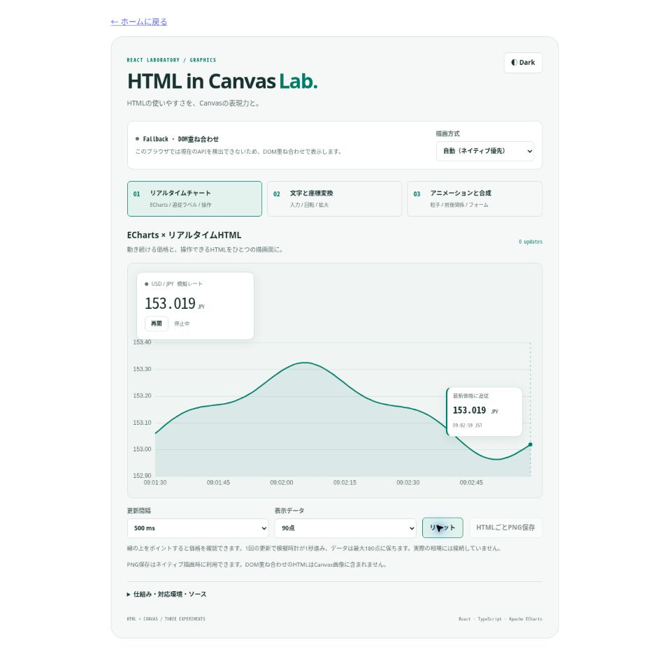

# HTML in Canvas Lab の確認画面

2026-11-08（日本時間）。共有検証ブラウザでチャートを一時停止し、模擬データを初期値に戻して撮影。

この画像はDOM重ね合わせのフォールバック動作を示します。検証ブラウザが現在のHTML-in-Canvas APIに未対応だったため、ネイティブの描画・PNG保存を実行できたことを示す画像ではありません。

実装・検証範囲は[サンプルのREADME](../../../src/experiments/html-in-canvas-lab/README.md)を参照してください。
